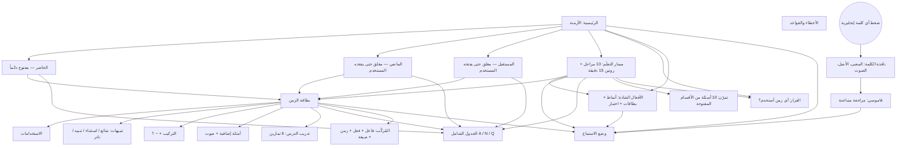

# English Tense — فهرس المشروع

> **اقرأ هذا الملف أولاً قبل أي تعديل.** هو خريطة العمل ونقطة التوقف.
> المشروع ضمن: **أكاديمية الفلاح** (تعليم).

| البند | القيمة |
|---|---|
| الرابط | https://gido70.github.io/English-Tenses/ |
| المستودع | `gido70/English-Tenses` (فرع `main`، النشر من الجذر) |
| الإصدار الحالي | **v2.3.1** |
| آخر تحديث | 2026-10-19 |
| النوع | تطبيق ويب للموبايل (PWA) — ملف HTML واحد + `sw.js` للعمل بدون إنترنت، بلا خادم وبلا قاعدة بيانات |

---

## 1. نقطة التوقف الحالية (ابدأ من هنا)

**آخر ما تم:** v2.3 — صفحة «مسار التعلّم»: 10 مراحل مرتّبة بالأزواج المتقابلة، روتين 15 دقيقة، مهام تُعلَّم تلقائياً، دفتر جمل شخصية مع صوت، و8 مبادئ للمتعلم الكبير. (قبله v2.2: مراجعة هادئة للعرض على الهاتف: شريط ثابت تحت ساعة/واي فاي الهاتف، شريط التحديث داخل الصفحة، فصل العربي (يمين) عن الإنجليزي (يسار) بأرقام ①②، العربي مطوية تُفتح وتُطوى، رأس مبسّط (EN + ⚙︎). (قبله v2.1: زر تحديث سريع 🔄 في الأعلى + شريط تلقائي «نسخة جديدة متاحة» + تسريع معالجة الصفحة. (قبله v2.0: وضع «الإنجليزي أولاً»: الشرح العربي مخفي خلف زر «ع» لكل عنصر، مع عناوين إنجليزية بديلة.) (v1.9: جدول شامل لكل مجموعة على طريقة سبورة الأستاذ (A/N/Q × الأزمنة)، صيغ النفي الكاملة مع الاختصار، أمثلة نفي إضافية، ونمط «when» للماضي المستمر والتام.)

**الحالة:** مستقر ومنشور. لا يوجد عمل ناقص.

**الخطوة التالية المقترحة (عند طلب المستخدم):**
0. مراقبة استخدام المستخدم للمسار وتعديل ترتيب المراحل حسب تقدّمه في الكورس.
1. المزامنة بقاعدة البيانات (القسم 6) — مؤجلة بقرار المستخدم.
2. ملفات صوت MP3 جاهزة بدل صوت الهاتف، تعمل والشاشة مقفلة — تحتاج توليد الصوت مسبقاً (مكلف نسبياً).
3. أفكار لاحقة: الأفعال الناقصة (can/should/must)، الشرطيات، المبني للمجهول — كأقسام مغلقة مثل الماضي والمستقبل.

---

## 2. خريطة الملفات

| الملف | الوظيفة |
|---|---|
| `index.html` | التطبيق كاملاً: التصميم + البيانات + المنطق |
| `manifest.webmanifest` | اسم التطبيق «English Tense» وأيقوناته عند الحفظ في الشاشة الرئيسية |
| `apple-touch-icon.png` | أيقونة آيفون (180px) |
| `icon-192.png` / `icon-512.png` | أيقونات أندرويد |
| `icon-maskable.png` | أيقونة أندرويد بهامش آمن |
| `og-image.png` | صورة معاينة الرابط في واتساب (1200×630) |
| `sw.js` | يحفظ التطبيق للعمل بدون إنترنت (الطائرة). **ارفع رقم `CACHE` فيه مع كل إصدار** |
| `PROJECT_INDEX.md` | هذا الملف |

> ⚠️ أسماء الملفات حساسة. خطأ سابق: رُفع الملف باسم `index (42).html` فظهرت صفحة 404.

---

## 3. خريطة التطبيق والتدفق

**الشريط السفلي:** الأزمنة · المُركِّب · قاموسي · تمرّن · الأخطاء
(صفحة «القرار» من الزر الكبير في الرئيسية.)

**قاعدة الأقسام المغلقة:** القسم المغلق لا يظهر في المُركِّب، ولا في الاختبار العام، ولا في الأخطاء والقواعد.

---

## 4. بنية الكود داخل `index.html`

| الجزء | ماذا فيه |
|---|---|
| `TENSES` | الأزمنة الـ 13. لكل زمن: `id`، `g` (present/past/future)، الاستخدامات، الصيغ، الكلمات الدالة، المقارنة |
| `PRACTICE` | 6 تمارين لكل زمن (الخيار الأول هو الصحيح دائماً، والعرض يخلط الترتيب) |
| `QUIZ` | أسئلة الاختبار العام، لكل سؤال `g` |
| `MISTAKES` | `[الخطأ، التصحيح، السبب، المجموعة]` |
| `RULES` | القواعد السريعة، لكل قاعدة `g` |
| `EXTRA` / `NOTES` / `PATTERNS` | الأمثلة الإضافية (كل مثال يُوسم تلقائياً A أو N أو Q) / التنبيهات / أنماط خاصة (when في pcont و pperf) |
| `ARX_SEL` / `markArx()` / `setEnFirst()` | وضع الإنجليزي أولاً: كل عنصر عربي تعليمي يطابق `ARX_SEL` يُخفى خلف «ع». زر `EN/ع` في الأعلى يبدّل الوضع. `t.enUse` و`u.en` عناوين إنجليزية |
| `checkUpdate()` / `doUpdate()` | التحديث: يقرأ `APP_VERSION` من النسخة المنشورة، وإن اختلف يمسح الكاش ويعيد التحميل. فحص تلقائي كل 10 دقائق عند فتح التطبيق |
| `separateMixed()` / `MX_EXCL` | أي فقرة فيها عربي وإنجليزي معاً تُعرض عموداً عربياً (يمين) فيه أرقام ①② وعموداً إنجليزياً (يسار) بنفس الأرقام. العناوين والجداول والأزرار مستثناة في `MX_EXCL` |
| `PATH` / `WHY` / `renderPath()` | مسار التعلّم. كل مهمة: `l` عربي، `e` إنجليزي في سطر منفصل، `a` الإجراء (tense / grid / irr / listen / go / irrquiz)، `auto` للتعليم التلقائي (نتيجة التدريب ≥ 4)، `w` مهمة كتابة. المرحلة التي فيها `unlock` تفتح قسم الماضي أو المستقبل |
| `openGrid(g)` | الجدول الشامل للمجموعة على طريقة السبورة. الصيغ الكاملة في `NEG` / `POS` / `QQ` |
| `GLOSS` / `IRR` / `lemma()` | قاموس مدمج (~420 كلمة) + تحويل الكلمة لأصلها (went → go) |
| `VERBS` + `build()` | مولّد جمل المُركِّب |
| `DEC` | شجرة أسئلة صفحة القرار |
| `isolateLatin()` | إصلاح اتجاه النص المختلط (انظر القسم 7) |
| `IRR_GROUPS` / `IRRV` | الأفعال الشاذة: 16 نمطاً (لكل نمط `tip` عربي بلا إنجليزي، `rule` إنجليزية، `ex` مثالان كاملان) و146 فعلاً (`s:1` = من الأهم 66). تُضاف معانيها وصيغها تلقائياً إلى `GLOSS` و`IRR` |
| `LS` / `PL` / `buildItems()` | وضع الاستماع: الإعدادات، المشغّل، وقائمة الجمل (الاستخدامات ← أمثلة الصيغ ← الأمثلة الإضافية) |

**مفاتيح الحفظ في المتصفح** (كلها تبدأ بـ `pt_`):
`dict` القاموس · `lp_<id>` نتيجة تدريب الدرس · `best` / `rounds` الاختبار العام · `unlocked` / `gexp` الأقسام المفتوحة والمطوية · `builder` إعدادات المُركِّب · `fsIdx` حجم الخط · `theme2` الوضع النهاري/الليلي · `page` آخر صفحة · `listen` إعدادات الاستماع · `irrs` حفظ الأفعال الشاذة · `irrf` فلتر الأهم/الكل · `igo` المجموعات المفتوحة · `enfirst` وضع الإنجليزي أولاً (افتراضياً مفعّل) · `path` تقدّم المسار ودفتر الجمل وأيام التعلّم · `pexp` المراحل المفتوحة.

---

## 5. سجل الإصدارات

كل إصدار محفوظ كـ **وسم (tag)** في GitHub، ويمكن استرجاع أي نسخة منه.

| الإصدار | التاريخ | التغييرات |
|---|---|---|
| v1.0 | 2026-10-14 | الأزمنة الأربعة للحاضر، المُركِّب، القرار، الاختبار، الأخطاء، حركة ثلاثية الأبعاد، خط Amiri، الأيقونات ومعاينة واتساب |
| v1.1 | 2026-10-15 | ألوان هادئة من COLOURlovers «Terra?»، تكبير/تصغير الخط، تدريب بعد كل درس |
| v1.2 | 2026-10-15 | الوضع النهاري البيج افتراضياً، والوضع الليلي اختياري |
| v1.3 | 2026-10-15 | الماضي (4) والمستقبل (5) كأقسام مغلقة، مع التمارين والمُركِّب والقرار |
| v1.4 | 2026-10-15 | تنبيهات لكل زمن، 100 مثال إضافي مع صوت، قاموسي مع مراجعة متباعدة |
| v1.5 | 2026-10-15 | إصلاح تداخل العربي والإنجليزي في النص |
| v1.6 | 2026-10-15 | تذكير «القاموس على هذا الجهاز فقط»، رقم الإصدار، هذا الفهرس |
| v2.3.1 | 2026-10-19 | إصلاح حيل أنماط الأفعال الشاذة: كانت النهايات (‑ew / ‑own) تظهر كأنها أفعال. الآن: شرح عربي (يمين، مطوي) + قاعدة إنجليزية بعناوين V2 / V3 ومثالان كاملان (يسار، ظاهرة دائماً) |
| v2.3 | 2026-10-19 | مسار التعلّم (10 مراحل، 47 مهمة)، بطاقة «التالي» أعلى الرئيسية، روتين 15 دقيقة، دفتر جمل شخصية مع 🔊، مبادئ التعلّم للكبار |
| v2.2 | 2026-10-19 | لا تداخل مع شريط الهاتف العلوي، خلفية حتى أسفل الشاشة، العربي/الإنجليزي منفصلان بأرقام، «عربي ▾ / إخفاء ▴» قابلة للطي، قائمة ⚙︎ (الخط، الوضع، التحديث)، تلميحات صفحة القرار بالإنجليزية فقط، شرح التمارين داخل المطوية كاملاً |
| v2.1 | 2026-10-19 | زر 🔄 للتحديث الفوري، شريط إشعار بالنسخة الجديدة، دمج أزرار الخط في زر Aa، معالجة الأجزاء المتغيرة فقط بدل الصفحة كاملة (أسرع) |
| v2.0 | 2026-10-19 | الإنجليزي أولاً: إخفاء الشرح والترجمة العربية خلف «ع» (يُفتح عند الحاجة)، عناوين إنجليزية للاستخدامات، «✓ Correct / ✗ Not quite» في التمارين، رموز A/N/Q بجانب الجملة |
| v1.9.1 | 2026-10-19 | بحث ثابت أعلى صفحة الأفعال الشاذة: يبحث في كل الـ 146 بأي صيغة أو بالعربي، يلوّن التطابق، ويقترح ‑ed للأفعال العادية |
| v1.9 | 2026-10-19 | جدول السبورة الشامل، النفي الكامل (did not … didn't)، أمثلة نفي لكل زمن (3 على الأقل)، رموز A/N/Q، كل الصيغ مفتوحة افتراضياً، نمط when |
| v1.8.1 | 2026-10-19 | نقل زرّي «الأفعال الشاذة» و«وضع الاستماع» إلى أعلى الرئيسية (المستخدم لم يجدهما في الأسفل) |
| v1.8 | 2026-10-19 | الأفعال الشاذة: 146 فعلاً بالأنماط، الأهم 66، بطاقات حفظ، اختبار بأخطاء شائعة (payed، goed)، استماع |
| v1.7 | 2026-10-18 | وضع الاستماع (دروس + كلماتي، تكرار، سرعة، ترجمة صوتية، وقف للترديد، منع انطفاء الشاشة) + العمل بدون إنترنت |

---

## 6. مؤجل: المزامنة بقاعدة البيانات 🔔

**قرار المستخدم (2026-10-15):** مؤجلة. تُضاف لاحقاً.

**المشكلة التي تحلها:** القاموس والتقدّم محفوظان على كل جهاز منفصلاً، فلا يظهران في جهاز آخر. الحل المؤقت: «حفظ نسخة / استرجاع نسخة» في صفحة القاموس.

**الخطة المتفق عليها:**
- **المشروع:** Supabase ← `alfalah-libraries` (`nmbbahzzogspuuvpsxud`)، وفيه جداول مسار وغيرها.
- **جداول جديدة فقط** بالبادئة `et_`، دون لمس أي جدول موجود:
  - `et_dictionary` (user_id، word، meaning، example، level، due_at، added_at)
  - `et_progress` (user_id، key، value jsonb)
- **RLS:** كل مستخدم يرى صفوفه فقط (`auth.uid() = user_id`).
- **تسجيل الدخول:** بالبريد (رمز أو رابط)، **اختياري**. التطبيق يبقى يعمل بدون إنترنت وبدون تسجيل.
- **أول تسجيل دخول:** رفع الكلمات الموجودة على الجهاز ودمجها.

---

## 7. قواعد ثابتة في المشروع (لا تُكسر)

1. **الخط العربي:** Amiri. **الإنجليزي:** Literata.
2. **لا خلفية بيضاء.** النهاري بيج مع لمسة زرقاء، والليلي كحلي «Terra?».
3. **ألوان الأزمنة حسب النوع لا الوقت:** Simple أخضر · Continuous أزرق · Perfect ذهبي · Perfect Continuous طوبي · going to بنفسجي.
4. **النص المختلط:** أي إنجليزي داخل نص عربي يُعزل تلقائياً كوحدة واحدة (`isolateLatin`). لا تعطّلها.
5. **كل جملة إنجليزية** تكون داخل عنصر بالصنف `en` حتى تصبح كلماتها قابلة للضغط والحفظ.
6. **أي كلمة جديدة في الأمثلة** تُضاف إلى `GLOSS` بمعناها العربي.
7. **التنبيهات بأمانة:** ما هو نادر يُقال إنه نادر.
7b. **كل زمن فيه إثبات ونفي وسؤال** في الصيغ والأمثلة (طلب المستخدم). رموز السبورة: A / N / Q، والتسمية V1 / V2 / V3 / V-ing.
7f. **لا تداخل عربي/إنجليزي في سطر واحد:** الشرح العربي يمين، والكلمات الإنجليزية يسار مرقّمة (تلقائي عبر `separateMixed`). عند كتابة محتوى جديد يُفضّل فصلهما من الأصل.
7g. **الهاتف أولاً:** لا شيء يظهر تحت شريط الهاتف العلوي، والرأس سطر واحد فقط. اختبر دائماً على عرض 375px.
7e. **الإنجليزي أولاً:** أي شرح أو ترجمة عربية جديدة يجب أن تطابق `ARX_SEL` (أو تُضاف لها) حتى تُخفى افتراضياً. واجهة التطبيق (الأزرار والعناوين) تبقى بالعربية.
7d. **ما يخص الأستاذ:** يُضاف فقط إذا كان يسهّل الفهم فعلاً، وليس شرطاً تطبيق كل شيء (توجيه المستخدم).
7c. **لا تخلط العربية داخل صيغة إنجليزية** (مثل fx) لأنها تُكسر الاتجاه.
8. **عند كل تعديل:** ارفع رقم `APP_VERSION` في `index.html` و`CACHE` في `sw.js`، وحدّث هذا الفهرس (نقطة التوقف + سجل الإصدارات)، وأنشئ وسماً جديداً.

---

## 8. طريقة النشر

- الرفع إلى `main` يُعيد نشر GitHub Pages تلقائياً خلال دقيقة تقريباً.
- بعد تغيير الأيقونات: يحذف المستخدم الاختصار من الهاتف ويضيفه من جديد.
- واتساب يحفظ معاينة الرابط القديمة، فللاختبار يُضاف `?v=رقم` في آخر الرابط.
