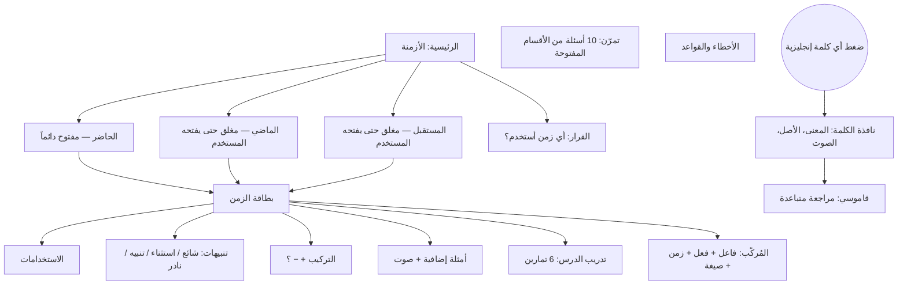

# English Tense — فهرس المشروع

> **اقرأ هذا الملف أولاً قبل أي تعديل.** هو خريطة العمل ونقطة التوقف.
> المشروع ضمن: **أكاديمية الفلاح** (تعليم).

| البند | القيمة |
|---|---|
| الرابط | https://gido70.github.io/English-Tenses/ |
| المستودع | `gido70/English-Tenses` (فرع `main`، النشر من الجذر) |
| الإصدار الحالي | **v1.6** |
| آخر تحديث | 2026-10-15 |
| النوع | تطبيق ويب للموبايل (PWA) — ملف HTML واحد، بلا خادم وبلا قاعدة بيانات |

---

## 1. نقطة التوقف الحالية (ابدأ من هنا)

**آخر ما تم:** v1.6 — إضافة تذكير «القاموس على هذا الجهاز فقط»، رقم الإصدار داخل التطبيق، وهذا الفهرس.

**الحالة:** مستقر ومنشور. لا يوجد عمل ناقص.

**الخطوة التالية المقترحة (عند طلب المستخدم):**
1. المزامنة بقاعدة البيانات (القسم 6) — مؤجلة بقرار المستخدم.
2. أفكار لاحقة: الأفعال الناقصة (can/should/must)، الشرطيات، المبني للمجهول — كأقسام مغلقة مثل الماضي والمستقبل.

---

## 2. خريطة الملفات

| الملف | الوظيفة |
|---|---|
| `index.html` | التطبيق كاملاً: التصميم + البيانات + المنطق |
| `manifest.webmanifest` | اسم التطبيق «English Tense» وأيقوناته عند الحفظ في الشاشة الرئيسية |
| `apple-touch-icon.png` | أيقونة آيفون (180px) |
| `icon-192.png` / `icon-512.png` | أيقونات أندرويد |
| `icon-maskable.png` | أيقونة أندرويد بهامش آمن |
| `og-image.png` | صورة معاينة الرابط في واتساب (1200×630) |
| `PROJECT_INDEX.md` | هذا الملف |

> ⚠️ أسماء الملفات حساسة. خطأ سابق: رُفع الملف باسم `index (42).html` فظهرت صفحة 404.

---

## 3. خريطة التطبيق والتدفق

**الشريط السفلي:** الأزمنة · المُركِّب · قاموسي · تمرّن · الأخطاء
(صفحة «القرار» من الزر الكبير في الرئيسية.)

**قاعدة الأقسام المغلقة:** القسم المغلق لا يظهر في المُركِّب، ولا في الاختبار العام، ولا في الأخطاء والقواعد.

---

## 4. بنية الكود داخل `index.html`

| الجزء | ماذا فيه |
|---|---|
| `TENSES` | الأزمنة الـ 13. لكل زمن: `id`، `g` (present/past/future)، الاستخدامات، الصيغ، الكلمات الدالة، المقارنة |
| `PRACTICE` | 6 تمارين لكل زمن (الخيار الأول هو الصحيح دائماً، والعرض يخلط الترتيب) |
| `QUIZ` | أسئلة الاختبار العام، لكل سؤال `g` |
| `MISTAKES` | `[الخطأ، التصحيح، السبب، المجموعة]` |
| `RULES` | القواعد السريعة، لكل قاعدة `g` |
| `EXTRA` / `NOTES` | الأمثلة الإضافية مع الترجمة / التنبيهات |
| `GLOSS` / `IRR` / `lemma()` | قاموس مدمج (~420 كلمة) + تحويل الكلمة لأصلها (went → go) |
| `VERBS` + `build()` | مولّد جمل المُركِّب |
| `DEC` | شجرة أسئلة صفحة القرار |
| `isolateLatin()` | إصلاح اتجاه النص المختلط (انظر القسم 7) |

**مفاتيح الحفظ في المتصفح** (كلها تبدأ بـ `pt_`):
`dict` القاموس · `lp_<id>` نتيجة تدريب الدرس · `best` / `rounds` الاختبار العام · `unlocked` / `gexp` الأقسام المفتوحة والمطوية · `builder` إعدادات المُركِّب · `fsIdx` حجم الخط · `theme2` الوضع النهاري/الليلي · `page` آخر صفحة.

---

## 5. سجل الإصدارات

كل إصدار محفوظ كـ **وسم (tag)** في GitHub، ويمكن استرجاع أي نسخة منه.

| الإصدار | التاريخ | التغييرات |
|---|---|---|
| v1.0 | 2026-10-14 | الأزمنة الأربعة للحاضر، المُركِّب، القرار، الاختبار، الأخطاء، حركة ثلاثية الأبعاد، خط Amiri، الأيقونات ومعاينة واتساب |
| v1.1 | 2026-10-15 | ألوان هادئة من COLOURlovers «Terra?»، تكبير/تصغير الخط، تدريب بعد كل درس |
| v1.2 | 2026-10-15 | الوضع النهاري البيج افتراضياً، والوضع الليلي اختياري |
| v1.3 | 2026-10-15 | الماضي (4) والمستقبل (5) كأقسام مغلقة، مع التمارين والمُركِّب والقرار |
| v1.4 | 2026-10-15 | تنبيهات لكل زمن، 100 مثال إضافي مع صوت، قاموسي مع مراجعة متباعدة |
| v1.5 | 2026-10-15 | إصلاح تداخل العربي والإنجليزي في النص |
| v1.6 | 2026-10-15 | تذكير «القاموس على هذا الجهاز فقط»، رقم الإصدار، هذا الفهرس |

---

## 6. مؤجل: المزامنة بقاعدة البيانات 🔔

**قرار المستخدم (2026-10-15):** مؤجلة. تُضاف لاحقاً.

**المشكلة التي تحلها:** القاموس والتقدّم محفوظان على كل جهاز منفصلاً، فلا يظهران في جهاز آخر. الحل المؤقت: «حفظ نسخة / استرجاع نسخة» في صفحة القاموس.

**الخطة المتفق عليها:**
- **المشروع:** Supabase ← `alfalah-libraries` (`nmbbahzzogspuuvpsxud`)، وفيه جداول مسار وغيرها.
- **جداول جديدة فقط** بالبادئة `et_`، دون لمس أي جدول موجود:
  - `et_dictionary` (user_id، word، meaning، example، level، due_at، added_at)
  - `et_progress` (user_id، key، value jsonb)
- **RLS:** كل مستخدم يرى صفوفه فقط (`auth.uid() = user_id`).
- **تسجيل الدخول:** بالبريد (رمز أو رابط)، **اختياري**. التطبيق يبقى يعمل بدون إنترنت وبدون تسجيل.
- **أول تسجيل دخول:** رفع الكلمات الموجودة على الجهاز ودمجها.

---

## 7. قواعد ثابتة في المشروع (لا تُكسر)

1. **الخط العربي:** Amiri. **الإنجليزي:** Literata.
2. **لا خلفية بيضاء.** النهاري بيج مع لمسة زرقاء، والليلي كحلي «Terra?».
3. **ألوان الأزمنة حسب النوع لا الوقت:** Simple أخضر · Continuous أزرق · Perfect ذهبي · Perfect Continuous طوبي · going to بنفسجي.
4. **النص المختلط:** أي إنجليزي داخل نص عربي يُعزل تلقائياً كوحدة واحدة (`isolateLatin`). لا تعطّلها.
5. **كل جملة إنجليزية** تكون داخل عنصر بالصنف `en` حتى تصبح كلماتها قابلة للضغط والحفظ.
6. **أي كلمة جديدة في الأمثلة** تُضاف إلى `GLOSS` بمعناها العربي.
7. **التنبيهات بأمانة:** ما هو نادر يُقال إنه نادر.
8. **عند كل تعديل:** ارفع رقم `APP_VERSION`، وحدّث هذا الفهرس (نقطة التوقف + سجل الإصدارات)، وأنشئ وسماً جديداً.

---

## 8. طريقة النشر

- الرفع إلى `main` يُعيد نشر GitHub Pages تلقائياً خلال دقيقة تقريباً.
- بعد تغيير الأيقونات: يحذف المستخدم الاختصار من الهاتف ويضيفه من جديد.
- واتساب يحفظ معاينة الرابط القديمة، فللاختبار يُضاف `?v=رقم` في آخر الرابط.
